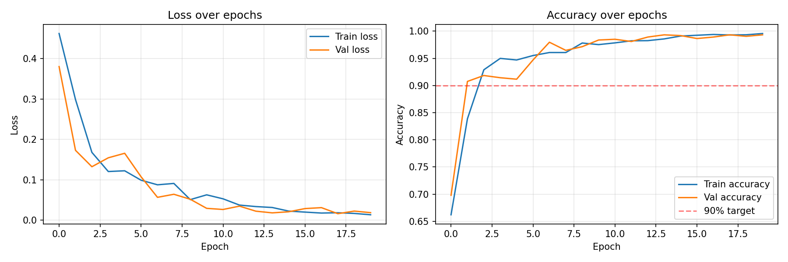
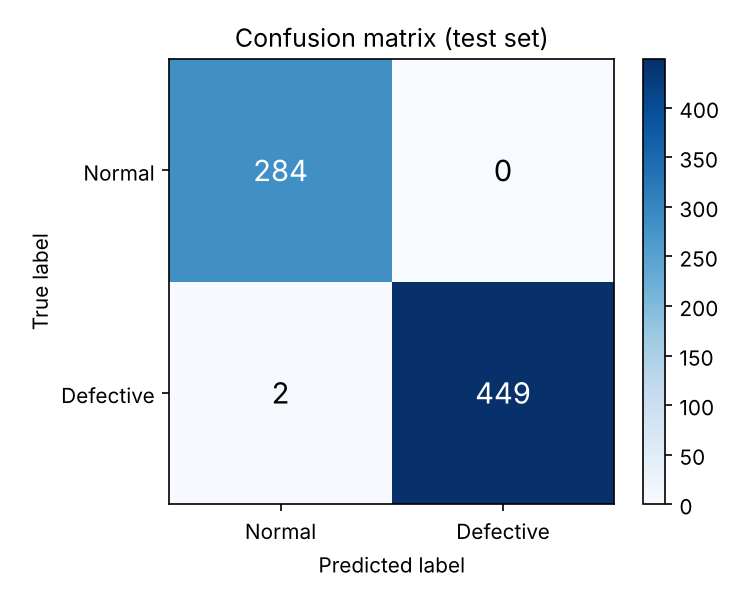
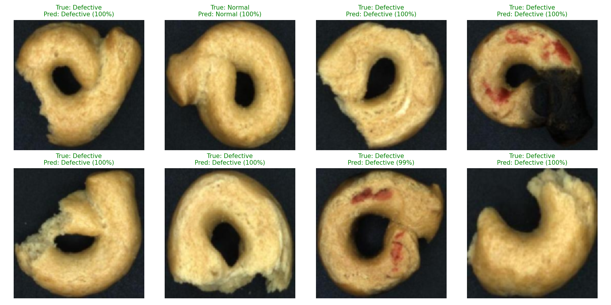

# Biscuit Image Classification

An image classification project for biscuit recognition using deep learning and
computer vision. A convolutional neural network, **built and trained entirely from
scratch in PyTorch** (no pretrained weights), classifies industrial biscuit (cookie)
images as either **normal** or **defective**.

> Built from the `biscuit_classification_complete.ipynb` notebook. All metrics,
> figures, and implementation details below are taken from that notebook's recorded
> outputs — nothing here is estimated or invented.

---

## Overview

Automated visual inspection is a classic quality-control problem on a production line:
given a photo of a biscuit, decide whether it is acceptable or defective. This project
trains a compact custom CNN to make that binary decision and evaluates it with
classification metrics appropriate for a mildly imbalanced dataset.

- **Task:** binary image classification (normal vs. defective)
- **Approach:** a 4-block convolutional neural network written from scratch in PyTorch
- **Constraint:** no pretrained weights or off-the-shelf architectures — the network is
  defined layer by layer
- **Dataset:** the Industry Biscuit (Cookie) dataset from Kaggle (~4,900 images)

## Problem statement and objectives

The dataset labels each image with one of four fine-grained classes: `Defect_No`
(a normal biscuit) and three defect types — `Defect_Shape`, `Defect_Object`, and
`Defect_Color`. For this project those are collapsed into a single binary label:

- `Defect_No` → **0 (normal)**
- any defect type → **1 (defective)**

The objective is to train a model that reliably separates normal from defective
biscuits, with a stated target of **over 90% test accuracy**, while tracking
precision and recall so that *missed defects* (false negatives) — the costly error in
quality control — are made visible rather than hidden behind raw accuracy.

## The classification task and features

- **Input:** a single RGB biscuit image, resized to 128×128.
- **Output:** one raw logit; applying a sigmoid gives the probability that the biscuit
  is defective. A threshold of 0.5 produces the final normal/defective decision.
- **Why binary:** the production question is simply "ship or reject," so the three
  defect sub-types are merged into one "defective" class.

## Dataset

| Property            | Value                                                                 |
| ------------------- | --------------------------------------------------------------------- |
| Name                | Industry Biscuit (Cookie) dataset                                     |
| Source              | [Kaggle](https://www.kaggle.com/datasets/imonbilk/industry-biscuit-cookie-dataset) |
| License             | LGPL-3.0 (third-party; **not** redistributed in this repo)            |
| Total images        | 4,900                                                                 |
| Class balance       | 3,004 defective (label 1) · 1,896 normal (label 0) — ≈61% / 39%       |
| Labels source       | `Annotations.csv` (`file`, `classDescription`, `classCode`)           |
| Image size fed to model | 128×128 RGB                                                       |

The dataset is **not included** in this repository. See
[`data/README.md`](data/README.md) for exactly how to download it and point the
notebook at it.

### Data split

A **stratified** split preserves the class ratio across all three partitions
(seed = 42):

| Split      | Images | Normal (0) | Defective (1) |
| ---------- | -----: | ---------: | ------------: |
| Train (70%)|  3,430 |      1,327 |         2,103 |
| Val (15%)  |    735 |        285 |           450 |
| Test (15%) |    735 |        284 |           451 |

## Model architecture

A custom CNN (`BiscuitCNN`) with **249,857 parameters**, all trained from scratch:

```
Input: 3 × 128 × 128 RGB
  │
ConvBlock 1 :  3 →  32    → 32 × 64 × 64
ConvBlock 2 : 32 →  64    → 64 × 32 × 32
ConvBlock 3 : 64 → 128    → 128 × 16 × 16
ConvBlock 4 : 128 → 128   → 128 ×  8 ×  8
  │
Global Average Pooling     → 128
  │
Flatten → Linear(128→64) → ReLU → Dropout(0.5) → Linear(64→1)
  │
Output: 1 raw logit  (sigmoid → P(defective))
```

Each `ConvBlock` is `Conv2d(3×3, padding=1) → GroupNorm → ReLU → MaxPool2d(2×2)`.
The notebook uses **GroupNorm** rather than BatchNorm so the block behaves identically
in training and evaluation mode (no running statistics), which the author notes was
done to remove validation-accuracy instability seen with BatchNorm. Global average
pooling keeps the dense head small and reduces overfitting on a dataset of this size.

## Preprocessing and augmentation

Two transform pipelines (both resize to 128×128, convert to tensor, and normalize to
roughly [-1, 1] with mean/std = 0.5 per channel):

- **Training (with augmentation):** random horizontal flip, random rotation (±15°),
  and mild `ColorJitter` (brightness/contrast ±10%). The jitter is deliberately kept
  mild because one defect type is `Defect_Color` — aggressive color changes would
  wash out the very signal the model needs.
- **Validation / test (no augmentation):** resize + normalize only, so scores reflect
  real performance on unaltered images.

A PyTorch `Dataset`/`DataLoader` pipeline (batch size 64) loads images, converting each
to RGB and falling back to a neighbouring sample if a file is unreadable.

## Training procedure

| Setting            | Value                                           |
| ------------------ | ----------------------------------------------- |
| Loss               | `BCEWithLogitsLoss` with `pos_weight ≈ 0.631`   |
| Optimizer          | Adam, learning rate 3e-4, weight decay 1e-4     |
| LR scheduler       | CosineAnnealingLR over 20 epochs                |
| Epochs             | 20                                              |
| Batch size         | 64                                              |
| Gradient clipping  | max-norm 1.0                                    |
| Seed               | 42                                              |
| Device (recorded)  | NVIDIA Tesla T4 GPU (CUDA)                       |

Class imbalance is handled with `pos_weight = n_normal / n_defective ≈ 0.631` in the
loss. After each epoch the model is evaluated on the validation set, and the weights
with the best validation accuracy are checkpointed, so the final reported model is the
best checkpoint rather than simply the last epoch.

## Results

Evaluated on the held-out **test set** (735 images) using the best checkpoint:

| Metric     | Value   |
| ---------- | ------- |
| Accuracy   | 0.9973  |
| Precision  | 1.0000  |
| Recall     | 0.9956  |
| F1 score   | 0.9978  |

This clears the project's >90% accuracy target. Precision of 1.0 means no normal
biscuit was flagged as defective (zero false positives); recall of 0.9956 means 2 of
451 defective biscuits were missed. The best **validation** accuracy during training
was 0.9932 (epoch 14).

> **Note on reproducibility.** The notebook also contains a "final results summary"
> cell whose recorded numbers (test accuracy 0.9891, best val 0.9946) differ slightly
> from the detailed training/evaluation cells quoted above (test accuracy 0.9973, best
> val 0.9932). This is because that summary cell was executed on a different run than
> the detailed cells. The figures reported here come from the detailed training-log and
> test-metric cells, which are internally consistent with one another. Expect small
> run-to-run variation; the headline conclusion (≈99% test accuracy, target met) is
> stable.

### Figures

Generated from the training run (see [`assets/`](assets/)):

| Training curves | Confusion matrix | Sample predictions |
| --- | --- | --- |
|  |  |  |

- **Training curves** — loss and accuracy per epoch for train vs. validation.
- **Confusion matrix** — test-set breakdown: 284 true normal, 449 true defective,
  0 false positives, 2 false negatives. *(This figure is regenerated from the recorded
  test metrics so it matches the numbers in the table above.)*
- **Sample predictions** — a grid of test images with true vs. predicted labels and
  confidences (green = correct, red = incorrect), exported directly from the notebook.

## Repository structure

```
biscuit-image-classification/
├── biscuit_classification_complete.ipynb   # the complete, runnable notebook
├── README.md                               # this file
├── requirements.txt                        # Python dependencies
├── LICENSE                                 # MIT (code only; dataset is separate)
├── .gitignore
├── data/
│   └── README.md                           # how to obtain & place the dataset
└── assets/
    ├── training_curves.png
    ├── confusion_matrix.png
    └── sample_predictions.png
```

The dataset folder and trained weights (`*.pth`) are intentionally **not** tracked.

## Technologies and libraries

Python · PyTorch · torchvision · NumPy · pandas · scikit-learn · matplotlib ·
Pillow · Kaggle API · Jupyter/Colab. Exact versions are pinned in
[`requirements.txt`](requirements.txt); the recorded run used Python 3.12,
PyTorch 2.11.0, torchvision 0.26.0, and scikit-learn 1.6.1.

## Prerequisites and installation

- Python 3.10+ (3.12 used for the recorded run)
- A GPU is recommended but not required; the notebook falls back to CPU automatically
- The dataset (see [`data/README.md`](data/README.md))

```bash
git clone https://github.com/NimaAhmadi79/biscuit-image-classification.git
cd biscuit-image-classification
python -m venv .venv && source .venv/bin/activate   # optional but recommended
pip install -r requirements.txt
```

## Running the project

### On Google Colab

1. Upload `biscuit_classification_complete.ipynb` to Colab (or open it from GitHub via
   *File → Open notebook → GitHub*).
2. Set the runtime to a GPU: *Runtime → Change runtime type → T4 GPU*.
3. Run the **Environment setup** cell — it detects Colab, mounts Google Drive, and
   sets `DATASET_DIR` to the project folder on your Drive.
4. To download the data from Kaggle inside Colab, provide your Kaggle token as an
   environment variable (do **not** paste it into a cell):
   the Kaggle-setup cell reads `os.environ["KAGGLE_TOKEN"]`.
5. Run all cells.

### Locally

1. Install dependencies (above) and obtain the dataset
   ([`data/README.md`](data/README.md)).
2. Put the data in a `biscuit_dataset/` folder next to the notebook, or point to it:
   ```bash
   export BISCUIT_DATA_DIR="/absolute/path/to/biscuit_dataset"
   ```
3. Launch Jupyter and run top to bottom:
   ```bash
   jupyter notebook biscuit_classification_complete.ipynb
   ```
   The **Environment setup** cell detects that you are not on Colab, skips the Drive
   mount, and uses your local path.

## Dataset setup and configuration

All paths derive from a single `DATASET_DIR`, defined in the Environment setup cell:

- **Colab:** `MyDrive/Colab_Notebooks/vision_for_insdusrty_project/biscuit_dataset`
- **Local:** `./biscuit_dataset` by default, or `BISCUIT_DATA_DIR` if set

Expected layout after download:

```
biscuit_dataset/IndustryBiscuit/
├── Images/            # 0001.jpg … 4900.jpg
├── Annotations.csv
└── DatasetFolder.py
```

## Limitations and possible improvements

- **Single run, no cross-validation.** Results come from one stratified split and one
  training run; k-fold cross-validation would give a more robust performance estimate.
- **Binary only.** The original four-way labels (`Defect_Shape`, `Defect_Object`,
  `Defect_Color`) are collapsed to normal/defective — multi-class defect
  classification is left as a natural extension.
- **Near-ceiling metrics.** ~99% test accuracy on this dataset suggests the task may be
  relatively easy for a CNN; testing on harder or out-of-distribution images would
  better probe generalization.
- **No exported inference script.** The notebook trains and evaluates end to end; a
  standalone `predict.py` for single-image inference would make the model easier to
  reuse.
- **Reproducibility seam.** As noted above, the summary cell and the detailed cells were
  run at different times; re-running the whole notebook once, top to bottom, would make
  every recorded number come from the same run.

## Acknowledgments and license

- Dataset: **Industry Biscuit (Cookie) dataset** by its Kaggle authors, used under
  LGPL-3.0. All credit for the data belongs to the original creators.
- Code in this repository is released under the **MIT License** — see
  [`LICENSE`](LICENSE). The MIT license covers the code only; the dataset remains under
  its own LGPL-3.0 terms and is not redistributed here.

## Author

**Seyed Nima Ahmadi** — [GitHub @NimaAhmadi79](https://github.com/NimaAhmadi79)
